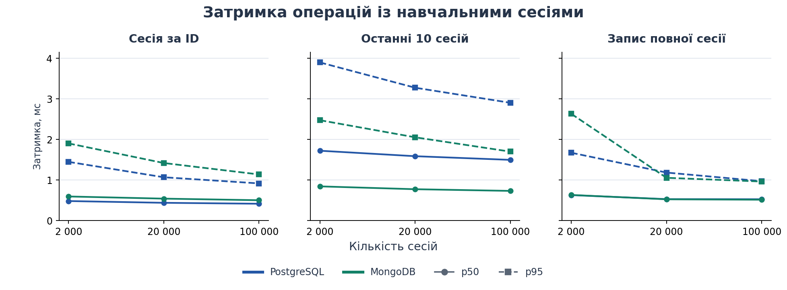

# Лабораторна робота №2. NoSQL
 
**Варіант:** система управління навчальними курсами  

## 1. Види NoSQL баз даних

| Тип | Як зберігаються дані | Типова задача | Приклад |
| --- | --- | --- | --- |
| Документна | Документи з полями, вкладеними об’єктами й масивами | Прочитати об’єкт разом із деталями | MongoDB |
| Ключ–значення | Доступ до значення за ключем | Тимчасовий стан, кеш, лічильники | Redis |
| Ширококолонкова | Рядки організовані за ключами розділів, а схема підбирається під запити | Масштабовані записи й вибірки в межах розділу | Apache Cassandra |
| Графова | Вузли та зв’язки з властивостями | Пошук шляхів або залежностей | Neo4j |

## 2. Вибір моделі для навчальної системи

Курси, студенти, записи та оплати залишаються в реляційній моделі першої лабораторної. Для них потрібні зовнішні ключі, контроль повторних записів і спільна транзакція запису та оплати.

Для другої лабораторної додано вимогу зберігати **історію навчальних сесій**. Після завершення сесії система зберігає її разом зі спробами проходження уроків і відповідями на тестові питання. Студент переглядає всю сесію або десять останніх сесій. Відповіді належать конкретній спробі й зазвичай читаються разом із нею. У документній моделі їх можна вкласти в один документ і отримати всю історію сесії одним запитом за її ID.

MongoDB доцільна для обмежених за розміром завершених сесій, які записуються й читаються цілком. Великі сесії з необмеженим масивом відповідей або запити, що аналізують окремі відповіді всіх студентів, потребували б іншої моделі та окремого вимірювання. Додаткова СУБД також потребує окремого резервного копіювання й обслуговування. Рішення про перенесення залежить від переваг у конкретних запитах.

## 3. Реалізація в MongoDB і PostgreSQL

| MongoDB · `study_sessions` | PostgreSQL · `nosql_lab` | Відповідність |
| --- | --- | --- |
| Один документ сесії | `sessions` | `_id` відповідає `id`. В обох зберігаються ID студента, ID курсу і час початку |
| Масив `attempts` | `attempts` | Спроба має ключ `(session_id, position)` і містить ID уроку, тривалість та оцінку |
| Масив `answers` у кожній спробі | `answers` | Відповідь має ключ `(session_id, attempt_position, question_no)` і посилається на спробу |

У SQL зовнішні ключі зв’язують відповіді зі спробами, а спроби із сесіями. ID курсу та студента в експерименті належать згенерованому набору даних. Час початку зберігається як Unix timestamp у секундах. Історія впорядкована за часом і ID за спаданням, щоб результат мав сталий порядок навіть при однаковому часі.

Ідентифікатор сесії індексується в обох базах. Для історії студента в обох моделях є складений індекс за ID студента, часом і ID сесії. SQL відновлює структуру сесії за допомогою `jsonb_agg` та `jsonb_build_object`. Для запису SQL отримує той самий об’єкт, розкладає його на рядки трьох таблиць і фіксує їх однією операцією. Дані в SQL зберігаються у звичайних стовпцях трьох таблиць.

## 4. Методика вимірювання

| Сесії MongoDB | Студенти | Рядки `sessions` | Рядки `attempts` | Рядки `answers` | Усього SQL-рядків |
| ---: | ---: | ---: | ---: | ---: | ---: |
| 2 000 | 100 | 2 000 | 8 000 | 24 000 | 34 000 |
| 20 000 | 1 000 | 20 000 | 80 000 | 240 000 | 340 000 |
| 100 000 | 5 000 | 100 000 | 400 000 | 1 200 000 | 1 700 000 |

Кожна сесія містить чотири спроби й три відповіді в кожній спробі. На одного студента припадає двадцять сесій. Зі зростанням набору збільшується кількість студентів і загальна кількість даних, а розмір окремої сесії та історії студента зберігається. Значення генеруються зі сталим зерном `42`, тому обидві бази отримують однакові дані.

| Сценарій | Що робить клієнт | Що вимірюється |
| --- | --- | --- |
| `by_id` | Читає сесію за ID | Повна сесія зі спробами й відповідями |
| `recent_10` | Читає історію студента | Десять повних сесій у тому самому порядку |
| `insert` | Записує нову сесію | Час до підтвердження повного запису |

Для кожного обсягу виконано п’ять раундів. У кожному раунді є 250 операцій кожного сценарію читання та 100 записів для кожної СУБД. Отже, на обсяг і СУБД припадає по 1 250 вимірювань для кожного виду читання і 500 для запису. Результати подано як медіану (p50) і 95-й перцентиль (p95, метод найближчого рангу).

Перед замірами перевіряються кількість сесій та рівність повних результатів обох баз на 30 випадково вибраних парах запитів для кожного обсягу. Це також прогріває з’єднання й частину кешу. Записи прогріваються окремими операціями. Під час тесту обидві бази отримують однакові ID або об’єкти, а порядок виклику баз чергується. Після кожного раунду запису тестові сесії видаляються поза таймером. Скрипт перевіряє кількість нових сесій і вміст останньої перед очищенням. На найменшому наборі дані протягом раунду запису зростають не більш ніж на 5%.

Заміри виконуються з боку Python через `perf_counter_ns` і враховують передачу даних через локальне TCP-з’єднання та перетворення відповіді драйвером. Створення з’єднань, генерація даних, початкове завантаження та перевірка правильності не входять у час. Початкове наповнення використовує `COPY` у PostgreSQL і `insert_many` у MongoDB. Це підготовка, а вимірюваний запис у кожній СУБД виконується по одній повній сесії. Для записів PostgreSQL використовує `fsync=on` і `synchronous_commit=on`, MongoDB підтверджує запис із `w=1, j=true`.

Експеримент описує послідовні запити одного клієнта після прогріву. Він не вимірює холодний запуск, паралельне навантаження, великі сесії або аналітику по всіх відповідях. Обидві СУБД запущені в одному середовищі. Межі їхніх кешів відрізняються через різну організацію пам’яті, а обидві також користуються файловим кешем ОС. Результат залежить від розміру даних, конфігурації, диска, версій СУБД і драйверів.

## 5. Результати

Вимірювання виконано в одному тестовому середовищі Linux x86_64 з Python 3.12.14, PostgreSQL 16.2 і MongoDB 7.0.23. PostgreSQL мав `shared_buffers=128MB`, а ліміт кешу WiredTiger становив 512 МіБ. Фактичні налаштування наведено в [environment.json](results/environment.json).

У таблиці наведено затримки в мілісекундах.

| Сесії | Операція | PostgreSQL p50 | PostgreSQL p95 | MongoDB p50 | MongoDB p95 |
| ---: | --- | ---: | ---: | ---: | ---: |
| 2 000 | Сесія за ID | 0,476 | 1,442 | 0,589 | 1,897 |
| 2 000 | Останні 10 сесій | 1,717 | 3,894 | 0,838 | 2,469 |
| 2 000 | Запис повної сесії | 0,622 | 1,667 | 0,627 | 2,626 |
| 20 000 | Сесія за ID | 0,433 | 1,062 | 0,536 | 1,414 |
| 20 000 | Останні 10 сесій | 1,582 | 3,270 | 0,768 | 2,048 |
| 20 000 | Запис повної сесії | 0,524 | 1,178 | 0,519 | 1,049 |
| 100 000 | Сесія за ID | 0,410 | 0,911 | 0,496 | 1,132 |
| 100 000 | Останні 10 сесій | 1,491 | 2,899 | 0,726 | 1,695 |
| 100 000 | Запис повної сесії | 0,521 | 0,966 | 0,509 | 0,957 |

- **Історія з десяти сесій.** На 100 000 сесій медіана MongoDB становила **0,726 мс** проти **1,491 мс** у PostgreSQL. Це приблизно у **2,05 раза менша затримка**. MongoDB повертає готові вкладені документи, а PostgreSQL для тієї самої відповіді збирає спроби й відповіді з двох дочірніх таблиць.
- **Одна сесія за ID.** На найбільшому наборі PostgreSQL мав меншу медіану, **0,410 мс** проти **0,496 мс**. На рівні всього запиту вимірювання охоплює також протокол і драйвер, тому його недостатньо, щоб приписати цю різницю окремому етапу.
- **Запис повної сесії.** На найбільшому наборі медіани близькі, **0,521 мс** у PostgreSQL та **0,509 мс** у MongoDB. Різниця близько **0,012 мс**, а порядок медіан змінюється між обсягами, тому цей запуск не встановлює стійкої переваги під час запису.

У [планах для 100 000 сесій](results/plans-100000.json) PostgreSQL використовує індекс `sessions_student_recent_idx` для історії та ключі `attempts_pkey` і `answers_pkey` для вкладених даних. MongoDB використовує `student_recent_idx` для історії та спеціалізований план `IDHACK` для запиту за `_id`. Таким чином, різниця в читанні історії спостерігалася за наявності відповідних індексів в обох моделях.

На цих трьох наборах зростання кількості сесій не збільшило медіану. Заміри виконано у прогрітому режимі й зі сталим розміром відповіді. Різницю між послідовними обсягами не можна приписати лише обсягу даних, оскільки змінювався стан кешів і фонових процесів.

Сирі дані містять [18 000 вимірювань](results/samples.csv). Підсумкові значення без округлення для таблиці збережено у [summary.csv](results/summary.csv).

## 6. Базові запити Redis

Redis використано як базу типу «ключ–значення» з різними структурами значень.

| Структура | Команди | Результат |
| --- | --- | --- |
| Рядок із TTL | `SET ... EX 60`, `GET`, `TTL` | Ключ показує, що студент активний, і автоматично спливає |
| Хеш | `HSET`, `HINCRBY`, `HGETALL` | Лічильник пройдених уроків збільшується з 2 до 3 з 4 |
| Впорядкована множина | `ZADD`, `ZINCRBY`, `ZREVRANGE ... WITHSCORES` | Після зміни бала рейтинг повертає 95, 90 і 65 балів у спадному порядку |

Запити виконано в Redis 7.4.2. Вивід збережено у [redis-demo.txt](results/redis-demo.txt).

## Висновок

Для повної історії студента MongoDB має практичний сенс, якщо читання кількох вкладених сесій становить значну частку запитів. У проведеному тесті ця операція мала приблизно вдвічі меншу медіанну затримку. Якщо переважає читання однієї сесії за ID, виміряні результати підтримують зберігання історії в PostgreSQL. Остаточний вибір також залежить від потреби в аналітиці та вартості підтримки другої бази. Redis підходить для тимчасового стану, лічильників і рейтингу.
